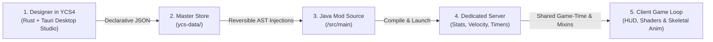

# Project Interview Walkthrough: yebisu-RPG & YCS4 Engine

- **Candidate:** Andreu Liam C. Gamboa (BS Computer Science - Software Engineering, FEU Alabang)
- **Role on This Project:** Lead Engine & Systems Developer
- **Target Company & Event:** Lamina Studios (Founder & Director Ms. April Gianan) – Initial Internship Interview (Friday, November 27, 2026)
- **Relevant Track Mentioned by Lamina Studios:** Desktop applications, real-time systems, game engine projects, and custom tooling suites.

---

## 1. One-Sentence Summary (The "Explain Like I'm 12" Version)

> *"As the Lead Engine & Systems Developer, I built a fast desktop creator app where game designers can visually assemble RPG items and ability logic, paired with a custom multiplayer game engine running in Java 21 that animates characters and executes combat smoothly with zero external library bloat."*

---

## 2. How It Works (Step-by-Step in Plain English)

Think of this project as two collaborative tools:
- **YCS4 (The Blueprint Workshop):** A desktop IDE built in Rust and Vanilla JS where you create items, hook up visual logic nodes, and configure HUD bars without touching Java code.
- **yebisu-RPG (The Game Engine & Stage):** The actual Minecraft mod (NeoForge 1.21.1 / Java 21) that reads those blueprints, runs combat logic on a dedicated server, and animates players smoothly in first- and third-person.

### The 5-Step Lifecycle:

1. **Step 1: Visual Authoring in YCS4 Desktop Studio**  
   - *Everyday Analogy:* **A Recipe Builder.**  
   - The developer or designer opens the YCS4 desktop studio. Instead of hand-coding Java classes for every weapon, they set properties (damage, attack speed, mana cost, texture icons) and link logic nodes on a visual canvas.

2. **Step 2: Safe Code Injection & Canonical Data Storage**  
   - *Everyday Analogy:* **A Precision Form Filler with Erasers.**  
   - YCS4 saves canonical data to human-readable JSON files in `ycs-data/`. The Rust backend then surgically inserts required code into Java source files between special comment markers (`// YCS_Mod_Items`). If an item is renamed or deleted, it cleans up only its own lines without touching handwritten custom code.

3. **Step 3: Dedicated-Server Authoritative Action**  
   - *Everyday Analogy:* **The Impartial Game Referee.**  
   - When a player triggers an ability (e.g. right-clicking a weapon to dash), the request goes to the server. The server verifies player resources (Mana, Stamina) via NeoForge `ModAttachments`, computes velocity and hitboxes, and ensures clients cannot cheat or drift out of sync.

4. **Step 4: Lockstep Shared-Clock Synchronization**  
   - *Everyday Analogy:* **Synchronized Wristwatches.**  
   - For multi-frame animated textures and timed visual effects, instead of flooding the network with 60 update packets every second, the client and server calculate animation frames as a pure mathematical function of `level.getGameTime()`. Both sides know the exact frame instantly with zero network overhead.

5. **Step 5: Surgical Rendering & Dynamic HUD Interception**  
   - *Everyday Analogy:* **A Custom Heads-Up Dashboard.**  
   - Using SpongePowered Mixins, the client intercepts the vanilla rendering loop right before it draws standard Minecraft hearts and food icons (`HudLayerHider`), suppressing them and drawing smooth-interpolating health, mana, and stamina bars with custom glowing shaders.

---

### Folder & Architecture Quick Reference ("Who Does What?")

| Directory / File | Engineering Purpose | Everyday Plain-English Analogy |
| :--- | :--- | :--- |
| `YCS4/` | Desktop application written with Tauri 2 (Rust backend + fast Vanilla JS frontend). Runs outside the game. | **The Control Room / Studio Suite** |
| `ycs-data/` | Canonical JSON files for items, attributes, HUDs, keybinds, and VFX. Independent of UI layout state. | **The Master Filing Cabinet** |
| `src/main/java/.../animation` | Native procedural animation blend engine (`AnimationBlender`, `TorsoRotationHolder`). | **The Choreographer / Puppeteer** |
| `src/main/java/.../network` | Custom server-client payload packets (`Payloads`) handling multiplayer synchronization. | **The Secure Walkie-Talkies** |
| `src/main/java/.../mixin` | Bytecode injections into Minecraft's entity, hand, and player renderers. | **The Surgical Splices** |
| `src/main/java/.../hud` | Dynamic HUD overlay engine and attribute clamp unlockers. | **The Custom Instrument Cluster** |
| `build.gradle` & `gradlew` | NeoForge build scripts and automated compiler pipeline. | **The Automated Assembly Line** |

---

## 3. Why It Was Built This Way (Key Engineering Decisions)

### Decision 1: Zero External Runtime Mod Dependencies
- **The Problem:** Many Minecraft RPG projects depend on third-party runtime libraries like GeckoLib, playerAnimator, or Curios. Whenever the base game updates or a server runs dozens of mods, conflicting animation systems cause crashes, memory spikes, or broken save states.
- **My Solution:** As Lead Engine Developer, I chose to implement all procedural torso aiming, matrix interpolation (`ItemRenderContextHolder`), and animation blending natively using direct NeoForge hooks and Mixins.
- **Plain English Takeaway:** *"I wanted complete control over performance and long-term stability. If the game updates, our system doesn't break waiting for third-party libraries to catch up."*

### Decision 2: Reversible Marker-Based Code Injections (`_injections`)
- **The Problem:** In earlier tools (v1–v3), visual creators either completely overwrote files (erasing manual changes developers made) or left behind zombie code when items were deleted.
- **My Solution:** Engineered an atomic, reversible injection engine in Rust. Generated code is enclosed between clear markers (e.g. `// YCS_Mod_Items`). YCS4 tracks injected line spans in metadata; if an asset is deleted in the UI, Rust cleans up exactly those lines without touching handwritten Java methods.
- **Plain English Takeaway:** *"It's like using labeled sticky notes on a shared team whiteboard. The tool only edits or removes its own sticky notes, so it never messes up handwritten team code."*

### Decision 3: Shared-Clock Networking vs. Packet Spamming
- **The Problem:** Broadcasting network packets every single tick to tell clients which animation frame or glowing texture to display burns network bandwidth and causes noticeable visual jitter under high server ping.
- **My Solution:** Visual timers and multi-frame texture animations are derived mathematically from `level.getGameTime()`. The server broadcasts only the trigger event (`VfxStartPayload`), and every client ticks the visual progress locally in lockstep with the game world clock.
- **Plain English Takeaway:** *"Instead of sending 60 text messages a second saying what time it is, we sync our clocks once and let the clock do the work."*

---

## 4. Hardest Challenges, Bugs & Edge Cases Solved

### Case 1: Environment Clash Between System JVM 8 and Gradle JVM 21
- **The Situation:** YCS4 includes a direct build-and-run bridge that lets creators click "Play" to spawn a Minecraft development client (`gradlew runClient`) directly from the desktop studio.
- **What Went Wrong:** Spawning Gradle from the launcher immediately failed with:  
  `Gradle requires JVM 17 or later to run. Your build is currently configured to use JVM 8.`
- **The Root Cause:** The host Windows OS had a legacy Oracle Java 8 entry prepended in the machine `PATH`, while no explicit `JAVA_HOME` was configured in the environment. Child command prompts spawned by the launcher inherited Java 8 instead of the Eclipse Temurin JDK 21 required by modern Minecraft 1.21.1.
- **How It Was Solved:** Configured the user-level `JAVA_HOME` directly to the JDK 21 installation and updated `YCS4/launch_ycs4.bat` to detect local JDK 21 paths and prepend `%JAVA_HOME%\bin` before launching the desktop studio or invoking Gradle child processes.

### Case 2: 3D Vector Math & Directional Dash Momentum
- **The Situation:** Implementing a right-click dash ability on custom weapons where player velocity should match their exact look direction.
- **What Went Wrong:** Playtesting showed that players dashing forward while facing East or West moved correctly, but dashing while facing North or South caused them to stop dead or lurch sideways.
- **The Root Cause:** In 3D space, horizontal forward movement relies on both X and Z coordinates. The dash calculation had accidentally hardcoded the Z component to zero:  
  `player.setDeltaMovement(look.x * 3, look.y * 3, 0 * 3)`.  
  Because facing North/South points along the Z axis, the player's forward vector was being zeroed out.
- **How It Was Solved:** Corrected the velocity application to scale the complete 3D look angle vector (`player.getLookAngle().scale(3.0)`), allowing seamless 360-degree mobility regardless of orientation.

### Case 3: Visual Ghost Reconciliation and Atomic In-Memory Deletion
- **The Situation:** In the desktop IDE, creators can create, edit, and delete RPG abilities from a dedicated "Abilities" workspace mode.
- **What Went Wrong:** Deleting test abilities removed their files from the disk, but the visual container shells persisted on the desktop grid even after reopening the app, and trying to delete them visually threw an error.
- **The Root Cause:** In the frontend's grid reconciliation loop, containers missing an active disk ID were skipped instead of pruned, allowing unlinked ghost cards to persist in `localStorage`. Concurrently, deletion logic prevented visual-only removal if backend commands reported that the file had already been deleted.
- **How It Was Solved:** Updated the reconciliation cycle to automatically identify and clean up unlinked or duplicate reference shells on startup, while making shell deletion resilient so visual objects are removed smoothly whether or not a backend JSON file still exists.

### Case 4: Missing Dispatch Class Imports on Custom Node Generation
- **The Situation:** Compiling visual node graphs (e.g. triggering third-person player animations during an ability use) generates Java code in `AbilityHandlers.java`.
- **What Went Wrong:** Running `gradlew runClient` failed compilation with `cannot find symbol: class Entity` and `cannot find symbol: variable AnimationAPI`.
- **The Root Cause:** The code generator emitted calls to `AnimationAPI.triggerThirdPersonAnimation` and `instanceof Entity`, but `AbilityHandlers.java` lacked imports for `Entity` and `AnimationAPI`.
- **How It Was Solved:** Added the required imports (`Entity`, `LivingEntity`, `AnimationAPI`, `DashUtil`, `ProjectileUtil`) to `AbilityHandlers.java` so newly generated ability nodes compile cleanly out of the box.

---

## 5. Easy Ways to Rephrase If They Don't Understand

If an interviewer looks puzzled by technical terminology, seamlessly pivot with these conversational phrases:

1. **If explaining Bytecode Mixins:**  
   *"In other words, instead of having to rewrite a massive 10,000-line game engine file just to change one animation behavior, Mixins let us slip in our two lines of custom code in memory as the game boots up."*

2. **If explaining Tauri 2 + Rust vs. Electron:**  
   *"In other words, think of it like building VS Code or Figma, but instead of using a heavy browser wrapper that hogs 500 MB of RAM, the core engine runs on Rust—so it starts up instantly and interacts with the hard drive at native speed."*

3. **If explaining Server-Authoritative Networking:**  
   *"In other words, the player's laptop never decides if an attack hit or how much mana they have left. The server is the referee holding the ledger; the player's screen just renders what the referee confirms."*

4. **If explaining Canonical JSON (`ycs-data/`):**  
   *"In other words, the desktop studio UI is just the steering wheel, but the JSON files are the actual engine. If the desktop app ever crashes, not a single piece of game data or configuration is lost."*

---

## 6. How This Connects to Lamina Studios

During the interview, bridge this project directly to what Lamina Studios cares about:

- **Full-Stack Desktop & Systems Engineering:** Lamina specifically highlighted experience in *desktop applications* and *real-time systems*. YCS4 proves hands-on ability to build native desktop applications combining modern web frontend UI with high-performance Rust backends and IPC communication.
- **Game Architecture & Tooling Mindset:** Game studios spend immense time building internal developer tools to help artists and level designers work faster. YCS4 showcases the ability to think like an engine/tools programmer who builds pipelines that empower other team members.
- **Multiplayer & Latency Discipline:** Demonstrates deep respect for dedicated server constraints—authoritative health/stat handling, bandwidth-conscious animation synchronization, and clean separation between simulation and presentation logic.
- **Cross-Disciplinary Versatility:** Matches your resume's blend of Software Engineering (BSCS-SE) with game design, visual arts, and UI/UX—giving you the communication tools to collaborate with both technical programmers and creative designers.

---

## 7. Quick Repo Sanity Check (Non-Breaking Only)

- **Compilation Status:** `gradlew compileJava` passes cleanly (`BUILD SUCCESSFUL` in <1s).
- **Authentication Cleaning:** Removed stale DevAuth OAuth prompts so game test runs launch immediately without blocking on external browser log-ins.
- **Registry Check:** Duplicate item entries resolved in `ModItems.java`; registries compile cleanly.
- **Documentation Alignment:** Root `README.md` cleanly represents the current dual architecture (`yebisu-RPG` engine and `YCS4` desktop studio) with verified screenshots and architectural milestones from `legacy/` (v1–v3) to v4.
- **Codebase Integrity:** All working engine logic, node graph scripts, and asset pipelines remain intact with zero breaking modifications.
