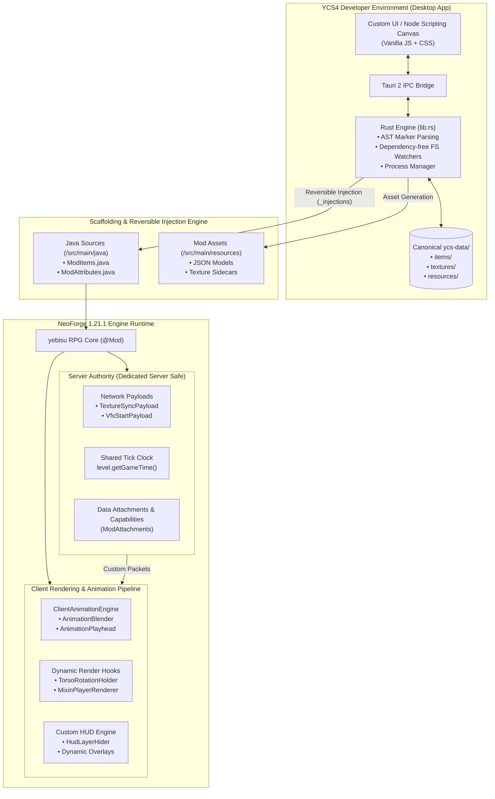

<div align="center">

# ⚔️ yebisu RPG

**A High-Performance Modular Action-RPG Engine & Visual Tooling Suite for Minecraft**  
*Engineered for Minecraft 1.21.1 (NeoForge) & Java 21 • Zero Runtime Dependencies • Dedicated Server Authoritative*

[](https://openjdk.org/)
[](https://neoforged.net/)
[](https://tauri.app/)
[](https://www.rust-lang.org/)
[](https://opensource.org/licenses/MIT)

<br />

<p align="center">
  
</p>
<p align="center"><em>In-game action interface featuring dynamic data-driven HUDs, custom combat mechanics, and live resource synchronization</em></p>

</div>

---

## 📌 Executive Summary

**yebisu RPG** is a full-stack game development project combining a custom **action-RPG engine mod** built natively on Minecraft 1.21.1 (NeoForge) with **YCS4 (yebisu Creator Studio 4)**, a bespoke desktop IDE and visual scaffolding suite built with **Tauri 2 and Rust**.

Unlike standard game mods that introduce heavy third-party runtime frameworks (e.g. GeckoLib, playerAnimator, Curios), **yebisu RPG was engineered from the ground up with zero required runtime dependencies**. Every core system—including skeletal animation blending, procedural torso rotation overrides, multi-layer emissive texture composition, dynamic HUD rendering, and server-authoritative state synchronization—is implemented natively at the bytecode and engine level.

Content creation is accelerated through **YCS4**, an external developer environment featuring a **node-based visual scripting canvas**, declarative JSON schemas, and a **Rust-powered reversible injection pipeline** that automatically maintains Java registrations, data generators, and assets without manual boilerplate.

---

## 📸 In-Game & Tooling Showcase

<div align="center">

### In-Game Visual Systems
<p align="center">
  
</p>
<p align="center"><em>Real-time server-authoritative attribute tracking, custom entity attachments, and dynamic combat layers</em></p>

### YCS4 Developer Studio & Node Pipeline
<p align="center">
  
</p>
<p align="center"><em>YCS4 Desktop IDE: Declarative workspace management, asset bundles, and visual graph editing</em></p>

</div>

---

## 🏗️ System Architecture



---

## ⚙️ Core Mod Architecture (`/src/main`)

### 1. Dedicated Server Authority & Synchronization
The entire multiplayer runtime is architected with strict client-server separation to guarantee compatibility with real dedicated servers (independent processes and network latency):
- **Deterministic Clocks:** Animated texture loops and timed effects calculate current state as a pure function of `level.getGameTime()`, eliminating client tick desynchronization and eliminating redundant network traffic.
- **Explicit Push Protocol:** Dynamic runtime states (e.g. dynamic texture layers, attached VFX) are stored server-side via `TextureAuthority` and dispatched to tracking players using custom network payloads (`TextureSyncPayload`, `VfxStartPayload`, `VfxRemovePayload`) on state change, player login, and entity track start.
- **NeoForge Data Attachments:** Player-specific RPG data, energy gauges, and runtime state machines are managed via `ModAttachments` rather than fragile NBT hacks or client-side singletons.

### 2. Custom Animation & Blend Engine (`/animation`)
Implemented natively to avoid heavyweight external animation runtimes:
- **`ClientAnimationEngine` & `AnimationBlender`:** Manages concurrent animation playheads with real-time spherical/linear interpolation between distinct movement and combat states.
- **`AnimationPlayhead`:** Tracks duration, blend weights, keyframe curves, and configurable loop modes (`HOLD`, `LOOP`, `ONCE`).
- **`TorsoRotationHolder`:** Overrides player torso pitch and yaw independently from head camera rotation during weapon swings, casting, and active skills.
- **`ItemRenderContextHolder`:** Intercepts first-person and third-person item transformation matrices to seamlessly align weapons and equipment with custom skeletal poses.

### 3. Dynamic Texture & Shading Pipeline (`/texture`, `/client/renderer`)
- **`TextureAuthority` & `TextureStack`:** Manages multi-layered sprite stacks per entity, enabling dynamic cosmetic layers, status effect overlays, and animated skins.
- **Emissive Shading Hooks:** Uses custom core shaders (`assets/yebisurpg/shaders/core/`) and `EntityTextureRenderHooks` to render fullbright/glowing textures on models and items without requiring OptiFine or Iris.
- **Masking & Clock Sync:** Supports multi-frame sprite sheets with configurable masking modes (`ADDITIVE`, `SUBTRACTIVE`, `ALPHA`) locked to game ticks.

### 4. Non-Invasive Bytecode Injections (`/mixin`)
Targeted SpongePowered Mixin injections into Minecraft's rendering pipeline:
- `MixinPlayerRenderer` / `MixinPlayerModel`: Injects custom bone transforms and dynamic rendering passes.
- `MixinItemInHandRenderer` / `MixinItemInHandLayer`: Overrides holding transforms and enables custom geometry rendering.
- `MixinLivingEntityRenderer` / `MixinSelfLitEntityRenderers`: Adds layered texture compositing directly into vanilla entity rendering loops.
- `AccessorRangedAttribute`: Unbounds attribute limits, allowing RPG health, defense, and speed values to scale beyond vanilla ceilings.

### 5. Data-Driven HUD & Resource Engine (`/hud`)
- **`HudLayerHider`:** Contextually suppresses vanilla GUI elements (hearts, armor, hunger, air) during RPG gameplay.
- **Dynamic Gauges:** Renders multi-tiered resource bars (HP, Mana, Stamina) with smooth value interpolation and custom texture backplates.

---

## 🛠️ YCS4 Tooling & Scaffolding Pipeline (`/YCS4`)

**YCS4 (yebisu Creator Studio 4)** is a dedicated visual development environment designed to eliminate boilerplate when building RPG systems.

### 1. High-Performance Hybrid Architecture
- **Tauri 2 + Rust Backend:** Native system I/O, process management, and file operations execute in compiled Rust (`YCS4/src-tauri/src/lib.rs`), providing instant responsiveness and low memory footprint.
- **Vanilla JS + CSS Frontend:** A custom lightweight UI designed without heavy frontend frameworks, ensuring rapid load times, custom pixel-art UI components, and direct DOM manipulation for maximum canvas FPS.

### 2. Reversible Code Injection (`_injections`)
A core engineering challenge in visual game modding tools is modifying Java source files without corrupting user edits. YCS4 solves this with a **transactional AST marker injection system**:
- Authored objects are stored strictly as declarative JSON under `ycs-data/<category>/<id>.json`.
- The Rust backend parses target files (such as `ModItems.java` and `ModAttributes.java`), inserting registration entries tagged with reversible metadata.
- When an object is updated or deleted in YCS4, the engine inspects the object's `_injections` record and cleans up the exact generated lines, model JSONs, and texture sidecars without touching hand-written code.

### 3. Node-Based Visual Gameplay Scripting
- **Typed Pins & Visual Wires:** Distinct data channels for `Number` (`#4d65b4`), `String` (`#5ba558`), `Boolean` (`#6494a4`), and `Entity` (`#30e1b9`).
- **Control Flow Separation:** Explicit distinction between execution flow (`Then -> Execute`) and data evaluation (`Output -> Input`).
- **Contextual Search (`Ctrl+Space`):** Dragging a wire and invoking search filters available nodes based on pin type compatibility and auto-inserts nodes between connected endpoints.
- **Adaptive Canvas:** Scale-aware marquee selection, pixel-snapped zoom/pan (50% to 250%), and auto-collapsing inline literal inputs when wired.

### 4. Integrated Gradle Daemon Bridge
YCS4 interfaces with the Gradle wrapper daemon via background child processes, allowing developers to trigger `./gradlew build` or launch test clients directly from within the studio UI while streaming task output in real time.

---

## 📁 Repository Structure

```text
yebisu-RPG/
├── .github/                  # CI/CD and repository workflows
├── docs/
│   └── images/               # In-game and tooling showcase media
├── legacy/                   # Historical iterations & prototypes (v1–v3)
│   ├── main/                 # Early Minecraft mod experiments
│   ├── tools/                # Early prototypes (V1, V2, and V3 Tauri/React studio)
│   └── README.md             # Architecture evolution case study
├── md/
│   ├── regular/              # Active technical specifications & architecture studies
│   └── skills/               # Reusable standards, UI checklists, and node direction
├── src/main/                 # Production NeoForge 1.21.1 Mod
│   ├── java/net/ye6isu/yebisuRPG/
│   │   ├── animation/        # Custom animation engine, playheads, and blender
│   │   ├── attribute/        # RPG attribute definitions and range unbounding
│   │   ├── client/           # Client-side render hooks, shaders, and debug tools
│   │   ├── component/        # NeoForge custom DataComponents
│   │   ├── entity/           # Custom entities and event listeners
│   │   ├── entityvar/        # Entity capability attachments
│   │   ├── hud/              # Custom GUI overlays and vanilla HUD suppressors
│   │   ├── item/             # RPG items, tool tiers, and creative tabs
│   │   ├── mixin/            # Bytecode injections (rendering, models, attributes)
│   │   ├── network/          # Custom packet payloads and sync handlers
│   │   ├── texture/          # Server-authoritative multi-layer texture engine
│   │   ├── vfx/              # Dynamic visual effect definitions and listeners
│   │   └── yebisuRPG.java    # Mod entry point and lifecycle bootstrap
│   └── resources/            # Assets, core shaders, animations, and models
├── ycs-data/                 # Canonical declarative authoring data (JSON)
│   ├── attributes/           # Custom RPG attribute definitions
│   ├── items/                # Item definitions and injection manifests
│   ├── resources/            # HUD gauges (HP, MP, Stamina)
│   └── textures/             # Texture metadata and sprite configurations
├── YCS4/                     # yebisu Creator Studio 4 (Tauri 2 Desktop IDE)
│   ├── src/                  # Vanilla JS frontend & node editor canvas
│   └── src-tauri/            # Rust backend (injection engine, IPC, process bridge)
├── build.gradle              # NeoForge build configuration (ModDevGradle)
├── gradle.properties         # Project metadata and version definitions
└── LICENSE                   # MIT License
```

---

## 💻 Tech Stack & Tooling

| Domain | Technologies & Libraries |
| :--- | :--- |
| **Game Modding Engine** | Java 21, NeoForge 1.21.1, Parchment Mappings, SpongePowered Mixin |
| **Desktop Tooling (YCS4)** | Rust (2021 Edition), Tauri 2.0, Vanilla JavaScript (ES6+), HTML5 / CSS3 Canvas |
| **Build System & Toolchain** | Gradle 9.x, ModDevGradle, Cargo |
| **Asset Formats** | Custom JSON Schemas, Minecraft DataComponent NBT, PNG Texture Sidecars |

---

## 🚀 Building & Running

### Prerequisites
- **Java Development Kit (JDK):** [Java 21](https://adoptium.net/) or newer installed and configured in `JAVA_HOME`.
- **Node.js & Rust** *(Optional, only if building the YCS4 desktop editor)*: [Node.js 18+](https://nodejs.org/) and [Rust / Cargo](https://rustup.rs/).

### 1. Build the Mod (`.jar`)
To compile the mod and generate a distribution jar:

```bash
# On Linux / macOS:
./gradlew build

# On Windows:
.\gradlew.bat build
```
The compiled mod artifact will be generated in `build/libs/yebisurpg-<version>.jar`.

### 2. Launch Development Client / Server
Test the mod directly in the development sandbox:

```bash
# Launch singleplayer / test client:
.\gradlew.bat runClient

# Launch dedicated server test environment:
.\gradlew.bat runServer
```

### 3. Launch YCS4 Developer Studio
To run the visual editor in development mode:

```bash
cd YCS4
npm install
npm run tauri dev
```

---

## 📜 License

This project is licensed under the [MIT License](LICENSE).
