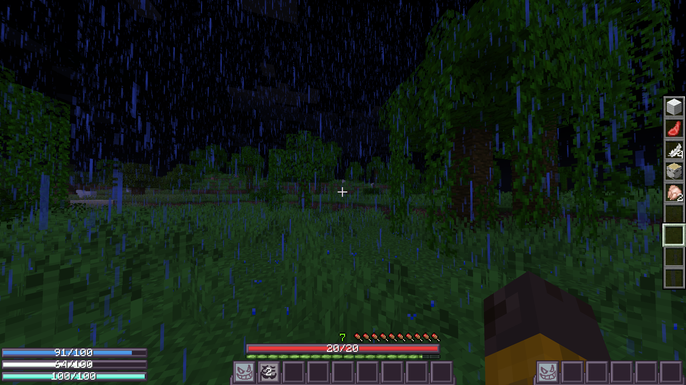
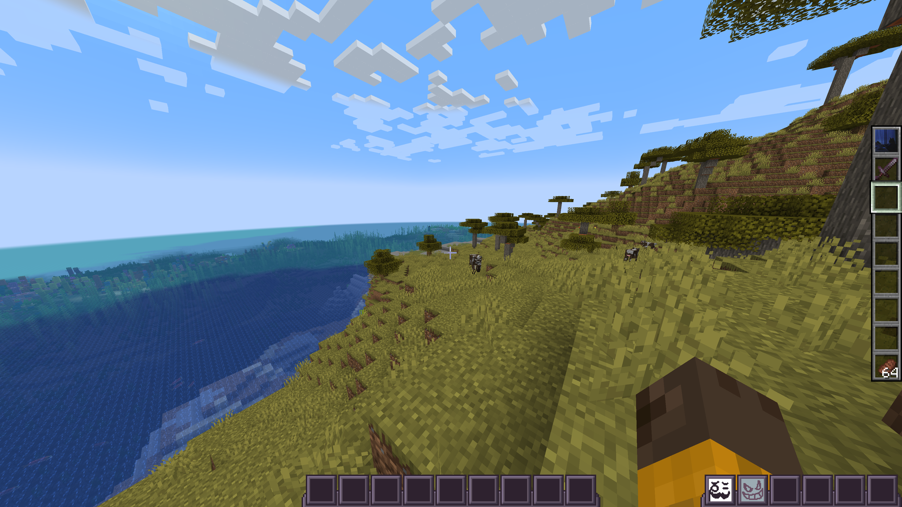
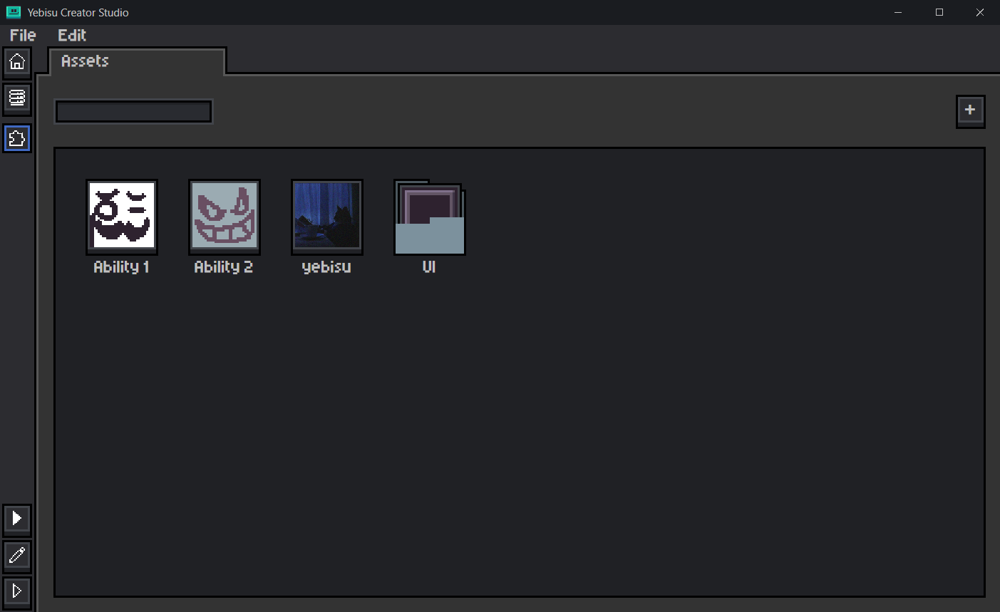
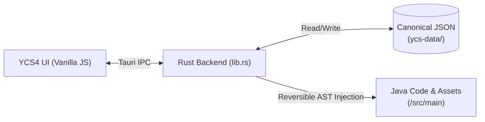

# yebisu-RPG & YCS4

A low-level game systems implementation, dedicated server networking architecture, and custom developer tooling suite for Minecraft (NeoForge 1.21.1 / Java 21) engineered with **zero runtime dependencies**.

---

## Overview

This repository consists of two integrated components:
1. **yebisu-RPG (`/src/main`)**: A NeoForge action-RPG mod implementing custom animation blending, procedural posing, multi-layer emissive rendering, dynamic HUD overlays, and dedicated-server authoritative networking—all built natively without external runtime mod libraries (no GeckoLib, playerAnimator, or Curios).
2. **YCS4 (`/YCS4`)**: A companion desktop IDE and visual scripting tool built with **Tauri 2 (Rust + Vanilla JS)** for declarative content authoring, reversible code scaffolding, and node-based gameplay logic.

---

## Screenshots

### In-Game Combat & Dynamic HUD

*Custom dynamic HUD replacing vanilla status bars, displaying real-time attributes and resource gauges.*

*Server-authoritative attribute tracking, player capabilities, and custom rendering passes.*

### YCS4 Developer Tool

*Desktop tool for asset inspection, declarative data management, and visual method authoring.*

---

## Mod Architecture (`/src/main`)

### 1. Dedicated Server Authority & Networking
Designed for real dedicated server environments with distinct client/server tick loops and network latency:
- **Shared Clocks:** Multi-frame animated textures and timed events are calculated as a pure function of `level.getGameTime()`, ensuring lockstep playback across clients without drifting or saturating network bandwidth.
- **Server Authority:** Dynamic visual states (such as active texture layers or spell effects) are tracked server-side via `TextureAuthority` and pushed to tracking clients via custom network packets (`TextureSyncPayload`, `VfxStartPayload`).
- **Data Attachments:** Player-specific RPG stats, stamina, and mana use NeoForge's capability-backed `ModAttachments` system.

### 2. Native Animation & Blend Pipeline (`/animation`)
Implemented natively with zero external animation dependencies:
- **`ClientAnimationEngine` & `AnimationBlender`:** Manages active animation tracks and performs real-time interpolation between combat movements and idle states.
- **`AnimationPlayhead`:** Controls duration, keyframe curves, blend weights, and loop modes (`HOLD`, `LOOP`, `ONCE`).
- **`TorsoRotationHolder`:** Procedurally adjusts player torso pitch and yaw during weapon swings and casting, independent of camera look direction.
- **Matrix Interception:** Uses `ItemRenderContextHolder` to properly orient held weapons in first-person and third-person viewports during custom animations.

### 3. Rendering, Mixins & Emissive Shaders (`/client/renderer`, `/mixin`)
- **Bytecode Injections:** Targeted SpongePowered Mixins (`MixinPlayerRenderer`, `MixinLivingEntityRenderer`, `MixinItemInHandRenderer`) hook into Minecraft's vanilla render passes without replacing base renderer classes.
- **Emissive Shading:** Custom core shaders (`assets/yebisurpg/shaders/core/`) and dynamic render layers support fullbright and glowing texture passes directly in vanilla pipelines.
- **Layered Texture Composition:** Runtime compositor layering sprite masks and dynamic overlays onto entities.

### 4. Dynamic HUD & Attribute Unbounding (`/hud`, `/attribute`)
- **`HudLayerHider`:** Intercepts vanilla GUI render events (`RenderGuiLayerEvent.Pre`) to suppress vanilla health, armor, food, and air bars.
- **`ModHud`:** Renders custom smooth-interpolating resource gauges (HP, Mana, Stamina) based on underlying player capabilities.
- **`AttributeRangeFix`:** Uses accessors to unlock vanilla attribute clamps, allowing RPG stats and health pools to scale freely.

---

## YCS4: Developer Tooling & Pipeline (`/YCS4`)

Built to eliminate boilerplate when registering game objects, **YCS4 (yebisu Creator Studio 4)** provides declarative content authoring and automated code generation.

### Key Engineering Features:
- **Hybrid Desktop Stack:** Native window management and file I/O built in **Rust** via **Tauri 2**, paired with a custom Vanilla JavaScript/CSS frontend for rapid startup and direct DOM rendering.
- **Reversible Code Generation (`_injections`):** To avoid corrupting handwritten Java code, YCS4 uses marker-based injection points. When an item or attribute is added, updated, or removed, the Rust backend tracks every generated line and cleanly cleans it up or updates it without touching manual code.
- **Data Authority:** All authored objects live as clean, human-readable JSON files in `ycs-data/`. The visual workspace layout is decoupled from the underlying data, meaning reorganizing UI folders never mutates source files.
- **Node-Based Gameplay Scripting:** Includes a node editor with typed pins (`Number`, `String`, `Boolean`, `Entity`), execution flow separation, contextual node search (`Ctrl+Space`), and interactive graph navigation (panning, zoom snapping, marquee selection).
- **Gradle Task Bridge:** Spawns and streams background Gradle tasks (`runClient`, `build`) directly within the desktop tool.

---

## Architectural Evolution (`/legacy`)

Prior to the current architecture, earlier iterations (v1–v3) explored various subsystem designs:
- **v1 & v2:** Early gameplay prototypes exploring basic item states and combat ideas.
- **v3:** An initial external tool prototype using React and Blocky visual scripting.
- **The Shift to v4:** Earlier attempts revealed issues with tight coupling between UI tools and Java source code, as well as the fragility of client-only mechanics. Those findings led directly to the clean separation, zero runtime dependencies, and reversible injection engine seen in the current repository.
- Historical code is preserved in [`legacy/`](legacy/) as an engineering case study (see [`legacy/README.md`](legacy/README.md)).

---

## Tech Stack

- **Game Engine Mod:** Java 21, NeoForge 1.21.1, Parchment Mappings, SpongePowered Mixin
- **Tooling:** Rust (Tauri 2), JavaScript (ES6+), CSS3 Canvas
- **Build System:** Gradle 9.x (ModDevGradle), Cargo

---

## License

This project is licensed under the [MIT License](LICENSE).
