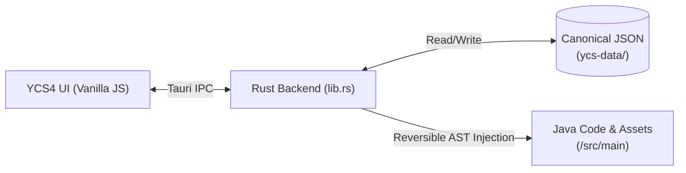

# yebisu-RPG & YCS4

A personal project exploring low-level game engine systems, dedicated server networking, and custom developer tooling for Minecraft (NeoForge 1.21.1 / Java 21).

---

## 📖 About This Project

This repository contains two main components that I developed together:
1. **yebisu-RPG (`/src/main`)**: A Minecraft action-RPG mod focused on combat mechanics, custom animations, multi-layer rendering, and strict multiplayer synchronization.
2. **YCS4 (`/YCS4`)**: A custom companion desktop IDE and visual scripting tool I built with **Tauri 2 (Rust + Vanilla JS)** to eliminate repetitive boilerplate and visually author game content.

### Why I Built This
Most Minecraft mods rely on heavy third-party runtime libraries (such as GeckoLib for animation or Curios for equipment slots). For this project, **I wanted to build everything from scratch with zero required runtime dependencies**. 

My goal was to understand and implement the foundational game systems myself:
- How to build a custom skeletal animation playhead and blend engine.
- How to maintain strict server authority and tick synchronization on real dedicated servers.
- How to inject into vanilla rendering pipelines using bytecode mixins and core shaders.
- How to design full-stack developer tooling that safely generates and modifies code without breaking hand-written sources.

---

## 📸 Screenshots

### In-Game Combat & Dynamic HUD

*Custom dynamic HUD replacing vanilla status bars, displaying real-time attributes and resource gauges.*


*Live server-authoritative attribute tracking, player capabilities, and custom rendering passes.*

### YCS4 Developer Tool

*The desktop tool I built to visually inspect assets, manage game data, and author gameplay logic.*

---

## 🛠️ Systems I Engineered

### 1. Dedicated Server Authority & Networking (`/src/main`)
Because this mod was designed to run on real dedicated servers (with distinct client/server tick loops and network latency), all gameplay and visual states are strictly partitioned:
- **Shared Clocks:** Multi-frame animated textures and timed events are calculated as a pure function of `level.getGameTime()`, ensuring smooth playback without drifting or flooding the network.
- **Server Authority:** Dynamic visual states (like active texture layers or spell effects) are stored on the server (`TextureAuthority`) and pushed to tracking clients via custom network packets (`TextureSyncPayload`, `VfxStartPayload`).
- **Data Attachments:** Player-specific RPG stats, stamina, and mana use NeoForge's capability-backed `ModAttachments` system.

### 2. Custom Animation & Blend Pipeline (`/animation`)
Rather than pulling in an external animation library, I implemented a lightweight animation system:
- **`ClientAnimationEngine` & `AnimationBlender`:** Manages active animation tracks and performs real-time interpolation between combat movements and idle states.
- **`AnimationPlayhead`:** Controls duration, keyframe curves, blend weights, and loop modes (`HOLD`, `LOOP`, `ONCE`).
- **`TorsoRotationHolder`:** Procedurally adjusts player torso pitch and yaw during weapon swings and casting, independent of camera look direction.
- **Matrix Interception:** Uses `ItemRenderContextHolder` to properly orient held weapons in first-person and third-person viewports during custom animations.

### 3. Rendering, Mixins & Emissive Shaders (`/client/renderer`, `/mixin`)
- **Bytecode Injections:** Used SpongePowered Mixins (`MixinPlayerRenderer`, `MixinLivingEntityRenderer`, `MixinItemInHandRenderer`) to hook into Minecraft's vanilla render passes without replacing entire renderer classes.
- **Emissive Shading:** Created custom core shaders (`assets/yebisurpg/shaders/core/`) and dynamic render layers to support fullbright and glowing texture passes directly in vanilla render pipelines.
- **Layered Texture Composition:** Developed a runtime compositor that layers sprite masks and dynamic overlays onto entities.

### 4. Dynamic HUD & Attribute Unbounding (`/hud`, `/attribute`)
- **`HudLayerHider`:** Intercepts vanilla GUI render events (`RenderGuiLayerEvent.Pre`) to suppress vanilla health, armor, food, and air bars.
- **`ModHud`:** Renders custom smooth-interpolating resource gauges (HP, Mana, Stamina) based on underlying player capabilities.
- **`AttributeRangeFix`:** Uses accessors to unlock vanilla attribute clamps, allowing RPG stats and health pools to scale freely.

---

## 💻 YCS4: Custom Developer Tooling (`/YCS4`)

As the mod grew, manually writing Java registration calls, JSON models, recipes, and texture metadata for every item became repetitive and error-prone. I built **YCS4 (yebisu Creator Studio 4)** to streamline this pipeline.



### Key Engineering Features:
- **Hybrid Desktop Stack:** Native window management and file I/O built in **Rust** via **Tauri 2**, paired with a custom Vanilla JavaScript/CSS frontend (no bloated frameworks, fast startup, and native canvas performance).
- **Reversible Code Generation (`_injections`):** To avoid corrupting handwritten Java code, YCS4 uses marker-based injection points. When an item or attribute is added, updated, or removed, the Rust backend tracks every generated line and cleanly cleans it up or updates it without touching the rest of the codebase.
- **Data Authority:** All authored objects live as clean, human-readable JSON files in `ycs-data/`. The visual layout in the desktop tool is decoupled from the data, meaning reorganizing UI folders never mutates source files.
- **Node-Based Gameplay Scripting:** Includes a prototype node editor with typed pins (`Number`, `String`, `Boolean`, `Entity`), execution flow separation, contextual node search (`Ctrl+Space`), and interactive graph navigation (panning, zoom snapping, marquee selection).
- **Gradle Task Bridge:** Spawns and streams background Gradle tasks (`runClient`, `build`) directly within the tool.

---

## 📂 Project Evolution (`/legacy`)

Before arriving at this architecture, I built three earlier iterations (v1–v3):
- **v1 & v2:** Early gameplay prototypes exploring basic item states and combat ideas.
- **v3:** An initial attempt at an external tool using React and Blocky visual scripting.
- **The Shift to v4:** Earlier attempts revealed issues with tight coupling between UI tools and Java source code, as well as the fragility of client-only mechanics. Those lessons led directly to the clean separation, zero-dependency model, and reversible injection engine seen here.
- The historical code is preserved in [`legacy/`](legacy/) as an engineering case study (see [`legacy/README.md`](legacy/README.md)).

---

## 🛠️ Tech Stack

- **Game Mod:** Java 21, NeoForge 1.21.1, Parchment Mappings, SpongePowered Mixin
- **Tooling:** Rust (Tauri 2), JavaScript (ES6+), CSS3 Canvas
- **Build System:** Gradle 9.x (ModDevGradle), Cargo

---

## 🚀 Building the Project

### Prerequisites
- JDK 21+ configured in `JAVA_HOME`

### Compile the Mod
```bash
# Windows
.\gradlew.bat build

# Linux / macOS
./gradlew build
```
The compiled jar will be in `build/libs/`.

### Run in Dev Environment
```bash
# Launch test client
.\gradlew.bat runClient

# Launch dedicated server test
.\gradlew.bat runServer
```

### Run YCS4 Tooling (Optional)
Requires Node.js 18+ and Rust:
```bash
cd YCS4
npm install
npm run tauri dev
```

---

## 📄 License

This project is licensed under the [MIT License](LICENSE).
